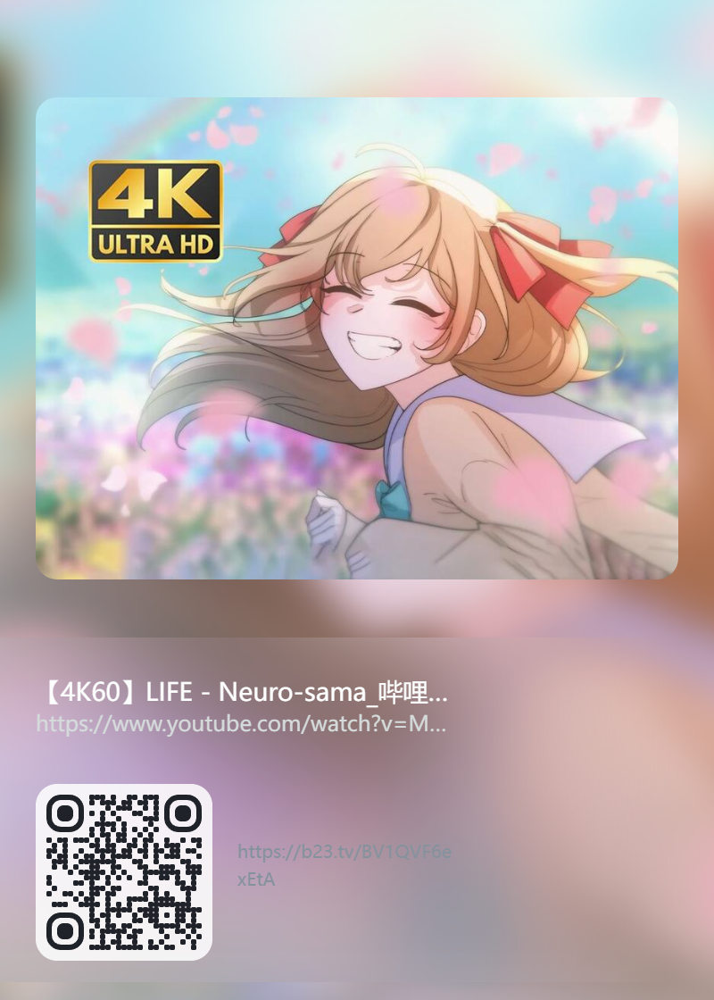
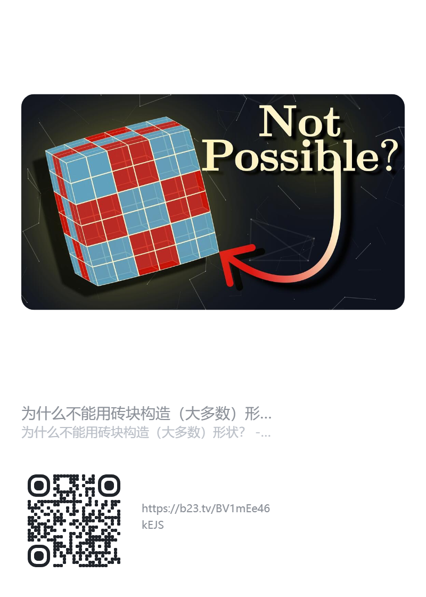
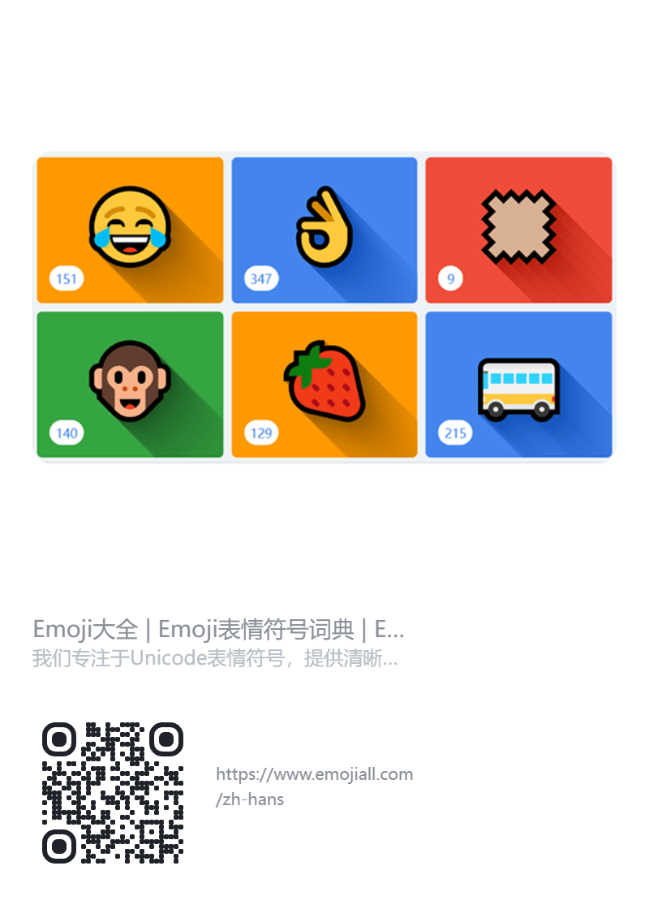

# 链接分享卡片

一个 Chrome 扩展（Manifest V3）：把当前网页一键生成一张可分享的卡片图片，自动复制到剪贴板，直接粘贴发送。

   
   
   

## 功能

- 自动读取当前页面的标题、描述、封面图（og:title / og:description / og:image，缺失时回退 favicon）
- 有封面时：封面放大模糊铺满卡片做背景，底部信息区为毛玻璃面板（左贴边、右侧淡出）
- 未取到封面时：纯白背景卡片
- 自动生成链接二维码（圆点风格），B 站视频页链接自动缩短为 `b23.tv` 短链
- 可自定义卡片大标题、备注（标题颜色、备注框底色与透明度可调），卡片宽高可调
- 生成后自动复制为 PNG 到剪贴板，聊天窗口直接粘贴
- 全程本地处理，不收集、不上传任何数据

## 安装（开发者模式加载）

1. 下载或克隆本仓库
2. 打开 Chrome，地址栏进入 `chrome://extensions`
3. 右上角打开「开发者模式」
4. 点击「加载已解压的扩展程序」，选择本仓库根目录
5. 工具栏出现扩展图标即安装成功

## 使用

1. 打开任意想分享的网页
2. 点击工具栏中的扩展图标
3. 按需填写：
   - **卡片标题**：顶部大字，留空则不显示；右侧色块可调标题颜色
   - **备注**：中部便签框，可用输入框下方的色块和滑杆调底色、透明度；留空且页面有封面时，中部会展示封面大图
   - **宽 / 高**：卡片逻辑尺寸，默认 400 × 560
4. 点击「生成并复制」，卡片即复制到剪贴板
5. 到聊天软件 / 文档里直接 Ctrl+V 粘贴

## 许可证

本项目的自有代码采用 [MPL-2.0](https://www.mozilla.org/en-US/MPL/2.0/) 许可证发布（`LICENSE` 文件见仓库根目录）。

各文件许可如下：

| 文件 | 许可证 | 版权 / 来源 |
|------|--------|-------------|
| `manifest.json` | MPL-2.0 | 本项目 |
| `popup.html` / `popup.css` / `popup.js` | MPL-2.0 | 本项目 |
| `card.js` | MPL-2.0 | 本项目 |
| `default_icon.png` | MPL-2.0 | 本项目 |
| `qrcode.js` | MIT | Copyright (c) 2009 [Kazuhiko Arase](https://github.com/kazuhikoarase/qrcode-generator)，文件头部保留其原始版权声明 |
